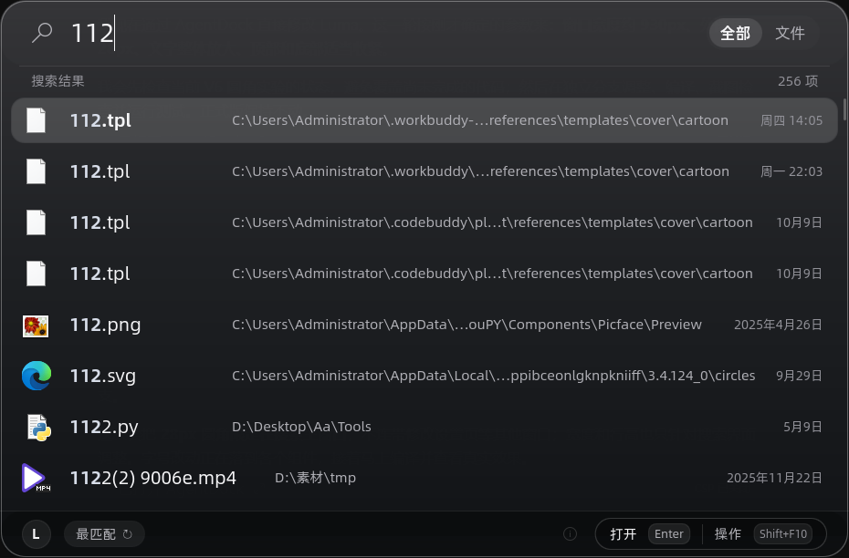
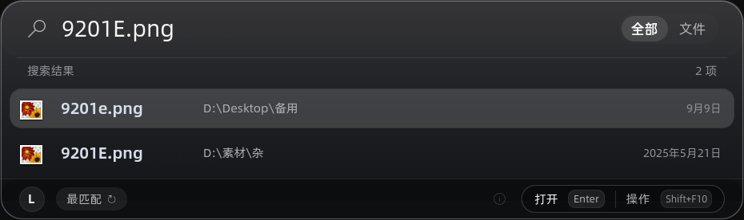

# Luma

**Luma** 是基于 [LingCore / WinShun](https://github.com/LingCore/WinShun)（MIT）维护的 Windows 10/11 搜索与快速启动器分支。保留其搜索、索引、剪贴板、插件、MCP 等主要能力，并使用独立的 **Luma 品牌、Windows 服务、安装身份和 Raycast 风格搜索主窗口**。原作者版权与 MIT 许可均保留。

> **版本：** Luma 0.8.1（Raycast V7）。与上游 WinShun 的版本号并不严格同步。当前上游 WinShun 0.9.0 的功能更新尚未合并，不能用上游安装包覆盖 Luma。

<p align="center">
  
</p>

<p align="center">
  <a href="https://github.com/buyuuz/Luma/releases/latest"></a>
  
  
  <a href="LICENSE"></a>
</p>

## Raycast 风格主窗口

<p align="center">
  
</p>
<p align="center">
  
</p>

Luma V7 搜索主窗口约 **930px** 宽，使用 Windows 10 下由 Qt 绘制的 **28px 平滑圆角**、深色玻璃风格、较大的搜索与结果文字。文件名、路径、日期以单行展示。右键或 `Shift+F10` 打开文件操作菜单；已有快捷键和后台功能仍保留。其他设置窗口不强制使用相同主题。

## 功能

- **本机文件搜索：** 拼音、首字母、文件名、文件夹、通配符及筛选，支持 NTFS MFT / USN 索引、收藏、最近打开和多选
- **文件内容搜索：** 文本、Word、Excel、PowerPoint、PDF 等，支持目录限定和 OCR 相关能力
- **快速启动：** 应用与 Windows 设置、网页搜索、插件、键盘快捷键
- **剪贴板历史：** 图片和文本记录、图片 OCR、窗口预览、搜索
- **文件对话框与任务栏：** 快速跳转文件夹、对话框搜索、任务栏入口
- **MCP：** 让受支持的 AI 客户端检索，遵循 Luma 的访问权限和默认安全设置

**主要快捷键：** 双击 `Ctrl` 唤出；`Enter` 打开；`Ctrl+Enter` 打开所在文件夹；`Tab` 切换范围；`Ctrl+S` 切换排序；`Shift+F10` 显示结果操作菜单；`Esc` 关闭窗口。详情见设置内的快捷键说明。

## 下载安装

从 **[Luma Releases](https://github.com/buyuuz/Luma/releases)** 获取对应版本：

- `Luma-版本-x64-setup.exe`：正式安装，包含 Luma 索引服务。安装或升级可能需要管理员权限，同一 Luma AppId 会覆盖旧 Luma 版本，保留已有用户配置与索引。
- `Luma-版本-x64-portable.zip`：解压使用，程序目录下的 `data` 文件夹存储便携配置。移除整个文件夹前先退出 Luma，并备份需要保留的数据。

安装版与便携版的数据可能位于不同目录；**不要直接删除 `data`、用户设置与索引目录来“清理旧版本”**。正式版未签名，SmartScreen 可能提醒，请核对 Release 和 SHA-256 校验值。

Luma **不会静默下载或替换自身**。界面的“检查更新”只检查 `buyuuz/Luma` 已发布的正式版本，不会直接套用上游 WinShun Release。

## 编译开发

Windows 10/11 x64，Visual Studio 2022（C++ Desktop）、Qt 6.8+（建议 Qt 6.12 MSVC 2022）、CMake 3.25+、Ninja。使用 PowerShell：

```powershell
.\scripts\build.ps1 -QtDir D:\Luma-Toolchain\Qt\6.12.0\msvc2022_64
.\scripts\build.ps1 -Deploy -QtDir D:\Luma-Toolchain\Qt\6.12.0\msvc2022_64
.\scripts\release.ps1          # 需要 Inno Setup；仅本地打包，不会发布
```

`scripts/release.ps1 -Publish` 会发布到 **buyuuz/Luma**，请仅在人工审核和测试通过后执行。为兼容上游的内部构建结构，某些 CMake target 和 QML module 仍使用内部名称 `WinShun`，这并不代表安装的程序或服务使用旧品牌。

## 上游更新与持续维护

当前的 Git 分支关系：

| 分支 / 标签 | 用途 |
| --- | --- |
| `main` | Luma 维护版正式源码，日常基线 |
| `ui/raycast-balanced-v7` | V7 UI 的独立历史快照，便于回溯 |
| `upstream/main` | `LingCore/WinShun` 上游最新代码，仅用于同步对比 |
| `sync/*` | 每次上游集成独立审核分支，不直接覆盖 main |
| `v0.8.0` / 新 Luma 标签 | 已发布的可回退版本 |

检查上游（只检查，不合并）：

```powershell
.\scripts\check-upstream.ps1
.\scripts\check-upstream.ps1 -Prepare  # 可选：创建本地审核分支，仍不合并
```

完整的冲突处理、品牌保护、权限安全和发布检查清单见 **[上游更新维护指南](docs/UPSTREAM_MAINTENANCE.md)**。此前的视觉调整记录位于 `docs/LUMA_*.md`。

## English

Luma is a Windows 10/11 x64 search and launcher fork based on **[LingCore/WinShun](https://github.com/LingCore/WinShun)**. It keeps the core file and content search features, clipboard history, plugins and MCP interface, while maintaining its own service identity, branding, and a Raycast-inspired Qt launcher. It is licensed under MIT; upstream copyright remains intact.

Download **Luma builds only** from [buyuuz/Luma Releases](https://github.com/buyuuz/Luma/releases), not the upstream WinShun installers. In-app update checks only look for official Luma releases and never silently replace files.

To inspect upstream code changes without merging them, run `./scripts/check-upstream.ps1`. For safe integration, see [Upstream maintenance](docs/UPSTREAM_MAINTENANCE.md).

## 许可与致谢

感谢 WinShun 原作者 **LingCore**。本仓库依据其 [MIT License](LICENSE) 维护分支并保留原作者版权。第三方 OCR、字体、库等继续遵守各自的许可证；详情可查 `third_party/`、`resources/` 和项目许可证文件。
